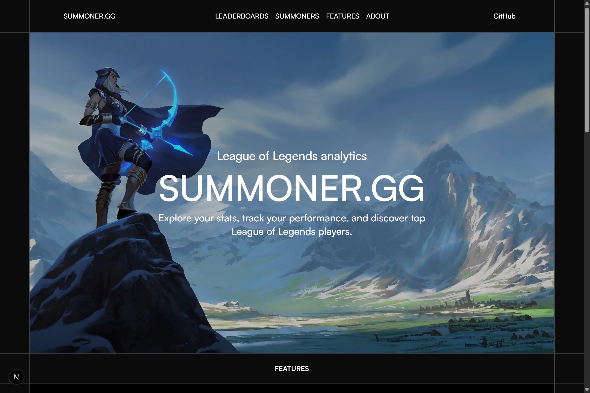
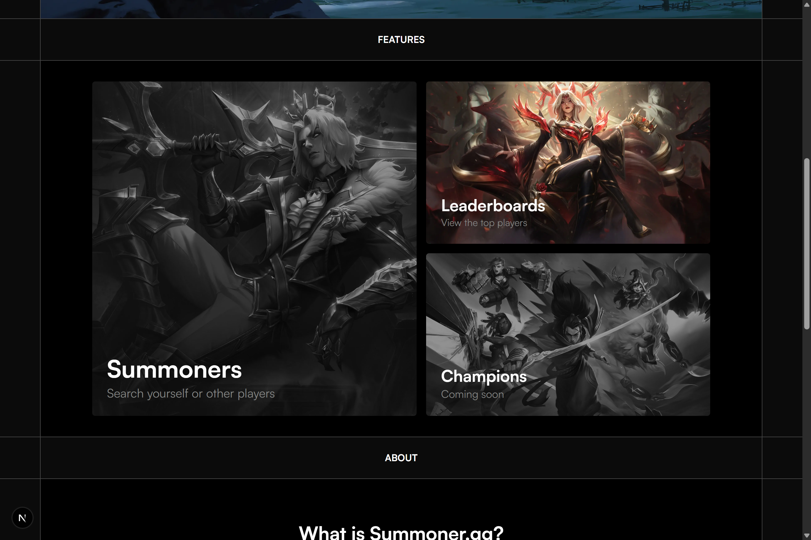
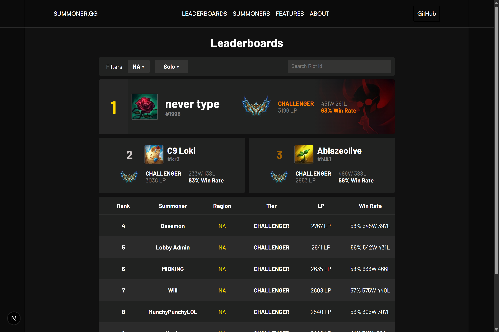
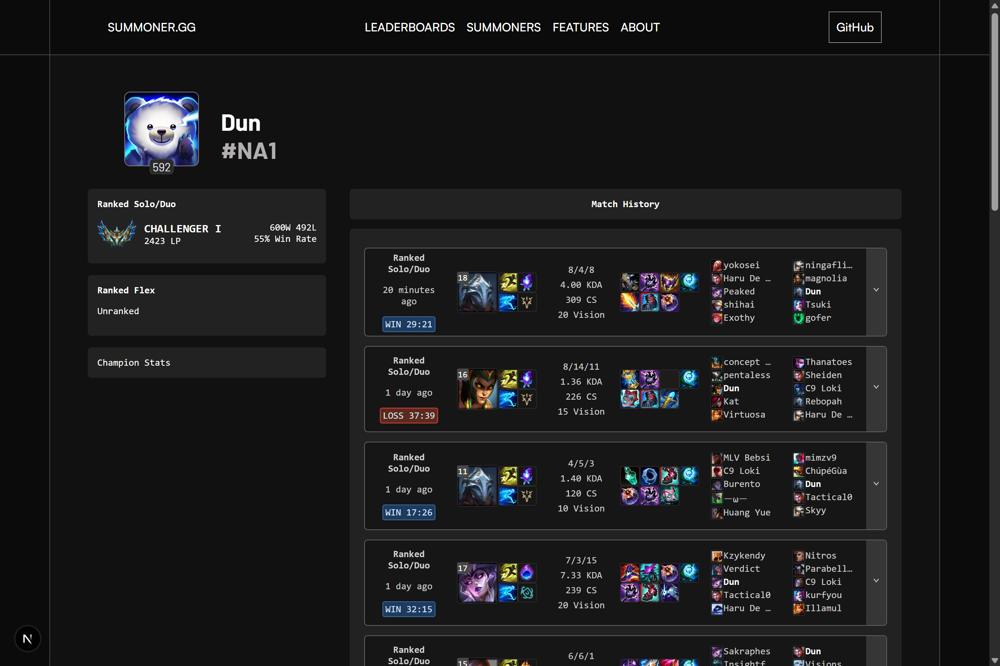
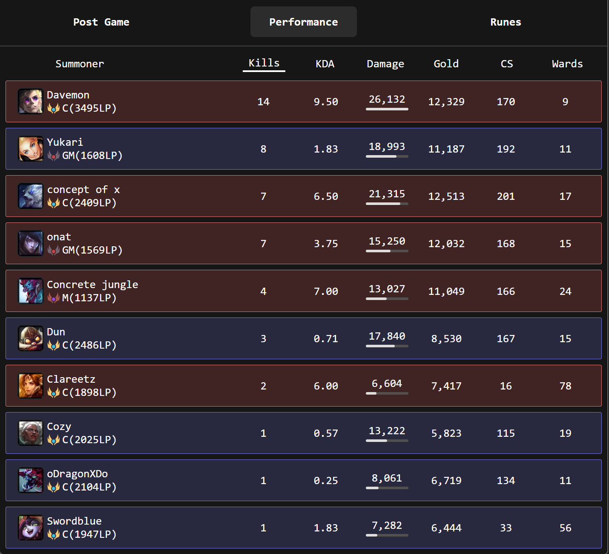
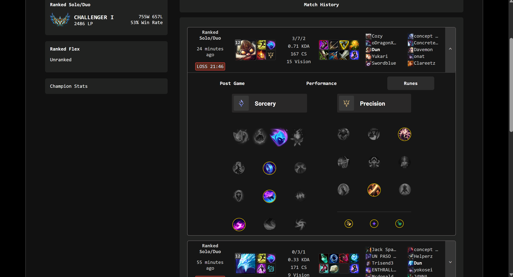
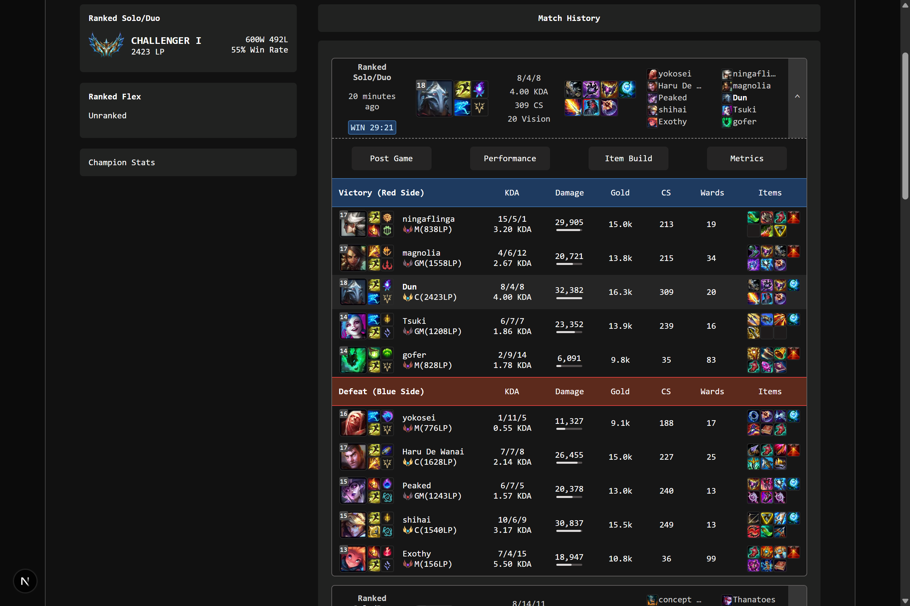

# Summoner.gg

### League of Legends Analytics Platform

**Live Demo:** [summoner-gg.vercel.app](https://summoner-gg.vercel.app/)

Summoner.gg is a full-stack League of Legends analytics platform that integrates the Riot Games API to provide player profiles, match history, ranked statistics, leaderboards, and champion performance analytics.

The project combines an ETL pipeline, PostgreSQL database-backed caching, and SQL-driven analytics to efficiently process match data and display meaningful champion statistics through an interactive interface.

## Screenshots

  
  
   
  
  
   
  
  
   
  

## Features

- **Player Profiles:** Search for players and explore their profiles, ranked statistics, and match history.
- **Match History:** View champions, results, KDA, roles, and other game statistics.
- **Detailed Match Breakdowns:** Explore builds, runes, summoner spells, and participant performance.
- **Champion Analytics:** Analyze matches played, pick rate, ban rate, and win rate through frontend statistics.
- **Leaderboards:** Browse rankings across supported regions and ranked tiers.
- **Persistent Data:** Store match data in PostgreSQL with database-backed caching.
- **Responsive UI:** Navigate player and match data through reusable React components and responsive layouts.

## Tech Stack

**Frontend**
- Next.js
- React
- TypeScript
- CSS Modules
- CSS3

**Backend & Data**
- Node.js
- PostgreSQL
- Neon
- Riot Games API
- Data Dragon

**Infrastructure & Tools**
- Docker
- Vercel
- Git
- GitHub
- pnpm

## Technical Highlights

### ETL Pipeline & Database-Backed Caching

- Engineered an ETL pipeline that extracts match data from multiple Riot Games API endpoints, transforms raw responses into application-specific structures, and loads structured records into PostgreSQL.
- Implemented database-backed caching, reducing repeat profile load times by **93%**, from 6.41 seconds to 455 milliseconds, while reducing redundant Riot Games API requests.
- Designed a repository-based persistence layer to separate database operations from application services.

### SQL-Driven Champion Analytics

- Developed SQL queries using common table expressions (CTEs) and conditional aggregation to calculate champion statistics, including matches played, pick rate, ban rate, and win rate.
- Integrated query results into the frontend to display champion performance statistics and support comparisons between champions.
- Considered sample-size differences when evaluating champion performance to make comparisons more meaningful.

### Full-Stack Application Architecture

- Built and deployed a full-stack application using Next.js App Router, React, and TypeScript.
- Designed a relational database schema for accounts, matches, participants, champions, items, runes, spells, and ranked snapshots.
- Integrated multiple Riot Games API endpoints to retrieve and process player, ranked, and match data.

### Frontend Development

- Developed reusable React components for player profiles, match history, leaderboards, and detailed match analytics.
- Implemented incremental match history loading using `IntersectionObserver`.
- Built responsive interfaces using custom CSS and CSS Modules.

### Deployment & Development Infrastructure

- Deployed PostgreSQL using Neon for persistent data storage.
- Used Docker to support local PostgreSQL development and testing.
- Deployed the web application through Vercel.

## Future Improvements

- Expand item, rune, and summoner spell statistics.
- Introduce patch-specific gameplay insights.
- Add match timeline visualizations.
- Expand regional and game-mode support.

## Disclaimer

Summoner.gg is an independent, fan-made project and is not endorsed by Riot Games.

League of Legends and Riot Games are trademarks of Riot Games, Inc.
